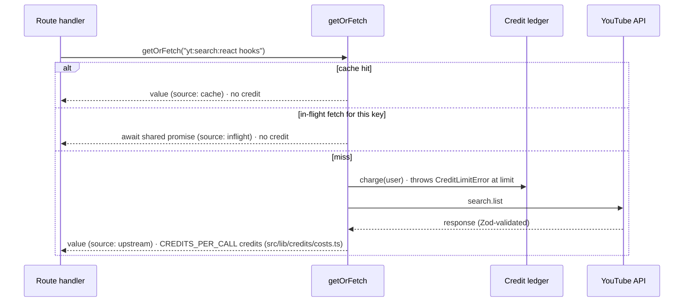

# video-search-cache

[](https://github.com/JahanzaibImran/video-search-cache/actions/workflows/ci.yml)

A YouTube video search app built with **Next.js 15 (App Router)**, **TypeScript (strict)** and **Tailwind CSS**. It shows how to put an external, quota-limited API behind a cache-first service layer with per-user usage limits.

Search for videos, browse result cards, and open a video to load its stats and top comments. Every YouTube call is cached, so the same query or video is never fetched (or paid for) twice. Each user has a credit budget that only goes down when the app really has to call YouTube.


> _Screenshot placeholder: add `docs/screenshot.png`._

## Features

- **Debounced search** with loading skeletons and empty, error and out-of-credits states
- **Result cards** with thumbnail, title, channel, publish date and a **cached / fresh** badge
- **Video detail panel** with views, likes and top comments, each with its own cache badge
- **Credits indicator** in the header ("3 of 20 credits used") with a friendly message at the limit
- **Setup screen** instead of a crash when `YOUTUBE_API_KEY` is missing
- **Typed end to end**: Zod-validated upstream responses and route inputs, plus a shared API contract between server and client

## How caching works

Every upstream call goes through `getOrFetch(key, fetcher, ttl)` with a stable, normalized key (`yt:search:{query}`, `yt:video:{id}`, `yt:comments:{id}`), so `"React Hooks"` and `"  react   hooks "` resolve to the same entry. On a miss, the pending request is kept in an in-flight map: concurrent requests for the same key await that one promise instead of calling YouTube again, and failed fetches are never cached, so they can be retried. The credit charge lives inside the fetcher, which only runs on a real miss and only for the one request leading a deduplicated fetch. Cache hits (and requests that joined someone else's fetch) are therefore free by construction. Credits measure upstream API spend, so a user who is out of credits can still view anything that's already cached.



### Credit rules

- Each upstream API call costs `CREDITS_PER_CALL` credits, set in one place: [`src/lib/credits/costs.ts`](src/lib/credits/costs.ts). The ledger, the API response (`meta.creditsCharged`) and the UI all read it from there. Users start with `CREDIT_LIMIT` (default 20).
- Opening an uncached video makes up to 2 upstream calls (`videos.list` + `commentThreads.list`), since each is cached separately.
- A call is only allowed if the user can afford its full price; the balance never goes over the limit.
- Each ledger entry stores the `amount` charged, so changing the price later doesn't rewrite past charges.
- At the limit, a miss fails with `CreditLimitError` (HTTP 402) **before** any network call.
- If the upstream call fails, the credit is refunded with a compensating ledger entry. The ledger is append-only, and each entry records `userId`, `action`, `cacheKey` and `timestamp`.
- Charging is atomic (check + record in one step), so parallel requests can't overspend.

## Architecture

Business logic lives in `src/lib`, framework-free and unit-tested. Route handlers and React components only wire things together.

```
src/
├── app/
│   ├── page.tsx                       # setup notice, or the app
│   └── api/
│       ├── search/route.ts            # GET /api/search?q=
│       ├── videos/[id]/comments/route.ts  # GET /api/videos/:id/comments
│       └── credits/route.ts           # GET /api/credits
├── components/                        # presentational React components (+ tests)
├── hooks/                             # useDebouncedValue, useApiQuery
├── lib/
│   ├── youtube/                       # typed client, Zod schemas, typed errors
│   ├── cache/                         # CacheStore interface, InMemoryCacheStore, keys, getOrFetch
│   ├── credits/                       # CreditLedger interface, in-memory ledger, CreditLimitError
│   ├── services/video-service.ts      # cache + credits + client, the core rules
│   ├── http/                          # user identity, error → HTTP mapping
│   ├── api/                           # shared request/response types + browser client
│   ├── config.ts                      # Zod-validated env
│   └── container.ts                   # composition root (swap in Redis/Postgres here)
└── test/                              # MSW server, YouTube fixtures, setup files
```

### API

| Endpoint                       | Success                                                    | Errors                                                                         |
| ------------------------------ | ---------------------------------------------------------- | ------------------------------------------------------------------------------ |
| `GET /api/search?q=`           | `{ query, results, meta, credits }`                        | `400` invalid input · `402` credit limit · `502` upstream · `503` quota/config |
| `GET /api/videos/:id/comments` | `{ video: {data, meta}, comments: {data, meta}, credits }` | same, plus `404` unknown video                                                 |
| `GET /api/credits`             | `{ credits: { used, limit, remaining } }`                  |                                                                                |

`meta` is `{ cacheKey, source: "cache" | "upstream" | "inflight", cached, fetchedAt }`. Error bodies are `{ error: { code, message }, credits? }`, and the API key never appears in them.

### Identifying users (demo only)

There's no real auth. A user is identified by an `x-user-id` header if present (handy for `curl` and tests), otherwise by an anonymous `httpOnly` cookie issued on the first request. Anyone can claim any id, which is fine for a demo but not for real billing; see below.

## Running locally

Requires Node.js 20.19+ (22 recommended) and a [YouTube Data API v3 key](https://console.cloud.google.com/apis/library/youtube.googleapis.com).

```bash
npm install
cp .env.example .env.local   # then set YOUTUBE_API_KEY
npm run dev                  # http://localhost:3000
```

| Variable               | Default | Description                                                   |
| ---------------------- | ------- | ------------------------------------------------------------- |
| `YOUTUBE_API_KEY`      | (none)  | Required for searching. Without it the app shows setup steps. |
| `CREDIT_LIMIT`         | `20`    | Credits each user starts with.                                |
| `YOUTUBE_API_BASE_URL` | Google  | Optional override, e.g. a local mock server for e2e runs.     |

Try it from the command line:

```bash
curl -H "x-user-id: demo" "http://localhost:3000/api/search?q=react%20hooks"   # source: upstream, used: 1
curl -H "x-user-id: demo" "http://localhost:3000/api/search?q=React%20Hooks"   # source: cache,    used: 1
```

## Tests

```bash
npm test              # run everything once
npm run test:watch    # watch mode
npm run ci            # lint + typecheck + tests (what CI runs, minus format and build)
```

Tests are written alongside each module with **Vitest**, **React Testing Library** and **MSW**. No test can reach the real YouTube API: unhandled requests fail the run. Coverage includes:

- **Cache:** hit, miss, TTL expiry, overwrite, eviction, key normalization
- **getOrFetch:** concurrent calls for one key make exactly one fetcher call; errors are not cached and can be retried
- **Credits:** charged on a miss, not on a hit, blocked before any API call at the limit, refunded on failure, no overspend under concurrency
- **YouTube client:** parses valid responses, rejects malformed ones, maps 403 quota reasons and 429 to `RateLimitError`, 404 to `NotFoundError`, and never leaks the API key
- **Route handlers:** happy path, credit limit (402), upstream errors (502/503), invalid input, missing config, cookie identity
- **Components:** search box debounce, Enter and loading state; result card data and cached/fresh badge; credits indicator

CI (GitHub Actions) runs format check, lint, typecheck, tests and a production build on every push.

## What I'd change for production

- **Shared cache:** a `RedisCacheStore` implementing the same `CacheStore` interface (GET / SET PX / DEL), so the cache survives restarts and is shared across instances. A Redis `SET NX` lock would extend in-flight dedupe across instances.
- **Persistent ledger:** a Postgres `ledger_entries` table with the atomic charge as a conditional insert or transaction, which also gives an audit trail and reporting.
- **Real auth:** derive `userId` from a verified session (e.g. NextAuth or Clerk) instead of a header or cookie anyone can set, and rate-limit per IP as a backstop.
- **Background refresh:** serve stale entries while revalidating them in the background (stale-while-revalidate), so popular queries never block on YouTube and TTL expiry doesn't cause latency spikes.
- **Observability:** metrics for hit rate, upstream latency, quota usage and credit exhaustion, plus alerts before the daily YouTube quota runs out.
- **Smarter costing:** weight credits by YouTube's quota cost per endpoint (`search.list` costs 100 units, `videos.list` 1) instead of one flat `CREDITS_PER_CALL` price for every endpoint.

## Tech stack

Next.js 15 · React 19 · TypeScript (strict, `noUncheckedIndexedAccess`) · Tailwind CSS 4 · Zod 4 · Vitest · React Testing Library · MSW · ESLint · Prettier · GitHub Actions
