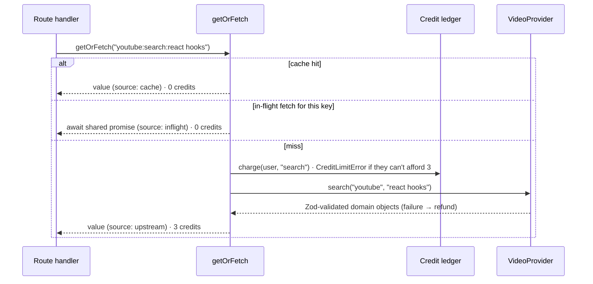

# video-search-cache

[](https://github.com/JahanzaibImran/video-search-cache/actions/workflows/ci.yml)

Search **YouTube and TikTok** videos, then pull their details, comments and transcripts. Built with **Next.js 15 (App Router)**, **TypeScript (strict)** and **Tailwind CSS**.

It puts paid, rate-limited video APIs behind a cache-first service layer with per-user credits:

- every result is cached, so the same video or query is never paid for twice;
- each user has a credit budget that only goes down when the app really calls upstream;
- the upstream API is swappable: the official **YouTube Data API**, or **ScrapeCreators** (YouTube + TikTok).


> _Screenshot placeholder: add `docs/screenshot.png`._

## Features

- **Search YouTube or TikTok** (toggle) with debounce, loading skeletons and empty, error and out-of-credits states
- **Paste any link** (YouTube watch, youtu.be, Shorts, embed; TikTok video, mobile, embed and `vm.tiktok.com` short links) to open that video directly
- **Video panel** with stats, top comments and an on-demand **transcript**, each with a **cached / fresh** badge showing what it cost
- **Credits indicator** in the header, including "not enough for a new search" when the balance is below the search price
- **Setup screen** instead of a crash when the selected provider's API key is missing
- **Typed end to end**: Zod-validated upstream responses and route inputs, plus a shared API contract between server and browser

## How credits work (per endpoint)

Prices live in **one file**, [`src/lib/credits/costs.ts`](src/lib/credits/costs.ts):

| Action         | Credits | When it's charged                                        |
| -------------- | ------: | -------------------------------------------------------- |
| `search`       |       3 | a search that isn't cached yet                           |
| `videoDetails` |       1 | the first time anyone opens a video                      |
| `comments`     |       2 | the first time anyone loads that video's comments        |
| `transcript`   |       2 | only when a user clicks "Load transcript" and one exists |

The ledger charges from this table, the API reports what each request was charged (`meta.creditsCharged`), and the UI's price list and messages read the same table. **Change a number there and behaviour, messages and tests all follow**; the test suite asserts against the table, not hardcoded numbers.

**What's free:**

- **Cache hits**, for everyone. The cache is shared, so once one user pays, everyone reads it free.
- **Failed calls.** The charge is refunded with a compensating ledger entry.
- **Answers with nothing usable:** comments turned off, or no transcript available. The call is refunded, and the answer is cached so we don't ask again.
- **Unsupported requests** (e.g. TikTok on the YouTube Data API). Refused before any charge or network call.

**Rules:**

- A call runs only if the user can afford **that action's full price**. With 2 credits left a 3-credit search is refused (HTTP 402, "A search costs 3 credits and you have 2 left") while a 1-credit video lookup still works. Out-of-credit users can still view anything cached.
- Charging is atomic (check + record in one step) and happens **before** the upstream call, which reserves the credits, so parallel requests can't overspend.
- The ledger is append-only. Each entry records `userId`, `action`, `cacheKey`, `amount` and `timestamp`. Because the amount is stored, changing a price never rewrites past charges.

> **Dev note:** the in-memory cache and ledger _data_ live on `globalThis` so they survive hot reloads, but the ledger and service _objects_ are rebuilt from current code. Editing `costs.ts` takes effect on the next request, no restart needed. (Previously the whole container was kept on `globalThis`, so a price edit was ignored until `npm run dev` restarted. `src/lib/container.test.ts` guards against that regression.)

## Providers

The service depends on one interface, `VideoProvider` ([`src/lib/providers/types.ts`](src/lib/providers/types.ts)):

```ts
interface VideoProvider {
  name: "youtube" | "scrapecreators";
  capabilities: Record<Platform, Record<"search" | "video" | "comments" | "transcript", boolean>>;
  search(platform, query): Promise<VideoSummary[]>;
  getVideo(ref): Promise<VideoDetails>;
  getComments(ref): Promise<CommentsResult>;
  getTranscript(ref): Promise<TranscriptResult>;
}
```

Providers map their raw payloads into provider-neutral domain types, so the service, routes and UI never see an upstream shape.

| Provider         | Env value                       | YouTube                               | TikTok                                |
| ---------------- | ------------------------------- | ------------------------------------- | ------------------------------------- |
| YouTube Data API | `VIDEO_PROVIDER=youtube`        | search, details, comments             | not supported                         |
| ScrapeCreators   | `VIDEO_PROVIDER=scrapecreators` | search, details, comments, transcript | search, details, comments, transcript |

The UI reads `capabilities` and only offers what the configured provider can do. The API refuses anything else with **422 `UNSUPPORTED`**, before charging.

### Switching providers

```bash
# .env.local
VIDEO_PROVIDER=scrapecreators
SCRAPECREATORS_API_KEY=your-key
```

Restart `npm run dev`. The choice is made in one place, [`src/lib/container.ts`](src/lib/container.ts). Adding a provider means implementing `VideoProvider` and adding a `case` there.

### ScrapeCreators notes

- Auth is the `x-api-key` header (never the URL, so keys can't leak into logs).
- Zod schemas ([`schemas.ts`](src/lib/providers/scrapecreators/schemas.ts)) were written from the official per-endpoint OpenAPI files (`https://docs.scrapecreators.com/{path}/openapi.json`). Those files publish response **examples**, not formal schemas, so the schemas are defensive: only the fields we read are declared, and anything plausibly absent is nullable. Assumptions are marked `TODO(assumption)` and should be verified with one live call each:
  - TikTok's per-post comment setting (`item_comment_settings: 3` = comments off) and a comment ID field (`cid`);
  - a "comments disabled" flag on the YouTube comments endpoint;
  - the error body shape (only 200 responses are documented);
  - building a TikTok URL without the author handle (`tiktok.com/@/video/{id}`).
- **Transcripts:** existing captions work for videos of any length on both platforms. TikTok's optional AI fallback (`use_ai_as_fallback`) only covers videos up to 2 minutes and costs 10 extra ScrapeCreators credits, so the app never enables it. "No transcript" is a normal `200` with `available: false`, not an error.
- TikTok search can return duplicates (per the docs); results are de-duplicated by ID.

## Caching

Every upstream call goes through `getOrFetch(key, fetcher, ttl)` with keys shaped `{platform}:{type}:{id}`:

```
youtube:search:react hooks     tiktok:search:wnba
youtube:video:dQw4w9WgXcQ      tiktok:video:7499229683859426602
youtube:comments:dQw4w9WgXcQ   tiktok:transcript:7499229683859426602
```

- **Queries** are normalized (Unicode, case, whitespace): `"React Hooks"` and `"  react   hooks "` share one entry.
- **Links** are normalized to `{platform, id}` by [`providers/urls.ts`](src/lib/providers/urls.ts), so `youtube.com/watch?v=ID&t=42s`, `youtu.be/ID?si=…`, `youtube.com/shorts/ID` and `m.youtube.com/watch?v=ID` all hit the same key. The same goes for TikTok's `@user/video/ID?is_from_webapp=1`, `m.tiktok.com/v/ID.html` and embed links. IDs keep their case (YouTube IDs are case-sensitive).
- **TikTok short links** (`vm.tiktok.com/…`) only reveal the video by redirecting. `/api/resolve` follows the redirect itself (free, no provider call) and only ever to `tiktok.com` hosts, so it can't be used to make the server fetch arbitrary URLs (SSRF).
- **In-flight dedupe:** concurrent requests for the same key share one upstream call and one charge.
- **Failures are never cached**, so they can be retried.
- **Validated before cached:** a response is cached only after Zod validation _and_ a check that it's the video we asked for.

TTLs ([`config.ts`](src/lib/config.ts)): search 30 min, video 6 h, comments 15 min, transcript 24 h.



## Comments: turned off vs none yet vs failed

These look alike ("no comments shown") but are different facts, and the app keeps them apart:

| State            | How we know                                                                                                              | API response (`comments` slot)                | Credits                             | UI                                                |
| ---------------- | ------------------------------------------------------------------------------------------------------------------------ | --------------------------------------------- | ----------------------------------- | ------------------------------------------------- |
| **Turned off**   | YouTube API `403 commentsDisabled`; TikTok's post setting (then the comments call is **skipped**); a ScrapeCreators flag | `{ data: { comments: [], disabled: true } }`  | **free** (refunded or never called) | "Comments are turned off for this video."         |
| **None yet**     | the call worked and returned an empty list                                                                               | `{ data: { comments: [], disabled: false } }` | charged (a real answer)             | "No comments yet. Comments are open…"             |
| **Fetch failed** | provider error, rate limit, bad response, or not enough credits                                                          | `{ error: { code, message } }`                | **free** (refunded)                 | error message + "Try again" (video stays visible) |

**Decision: turned-off comments are free.** The user asked for comments and received none they can read, so charging would feel like paying for an error. We absorb the small upstream cost. A comments failure no longer fails the whole request: `GET /api/videos/:platform/:id` returns `200` with the video and the error in the comments slot. Only a failure to load the _video_ fails the request.

## Validation and errors

Every provider response passes through a single `request()` function per provider that validates it with Zod. Any unexpected shape (`null`, wrong types, a missing list, an HTML error page) becomes a typed `UpstreamError` with `reason: "invalid_response"` or `"invalid_json"`, never a crash or an `undefined` in the UI. Internal details (endpoint, status, Zod issues) are logged on the server. The browser gets fixed copy keyed by `code`:

| Code                    | HTTP | User sees                                                                                  |
| ----------------------- | ---: | ------------------------------------------------------------------------------------------ |
| `UPSTREAM_ERROR`        |  502 | "The video provider didn't respond as expected, so nothing was charged. Please try again." |
| `UPSTREAM_RATE_LIMITED` |  503 | "The video provider is rate-limiting us right now…" (+ `Retry-After`)                      |
| `NOT_FOUND`             |  404 | "That video couldn't be found. It may be private or deleted."                              |
| `CREDIT_LIMIT_REACHED`  |  402 | "A search costs 3 credits and you have 2 left…"                                            |
| `UNSUPPORTED`           |  422 | "The current video provider doesn't support that. No credits were used."                   |
| `INVALID_INPUT`         |  400 | what was wrong with the input                                                              |
| `NOT_CONFIGURED`        |  503 | "The server is missing its video provider API key."                                        |

## API

| Endpoint                                      | Success                                                               | Notes                                                              |
| --------------------------------------------- | --------------------------------------------------------------------- | ------------------------------------------------------------------ |
| `GET /api/search?q=&platform=youtube\|tiktok` | `{ query, platform, results, meta, credits }`                         | `platform` defaults to `youtube`                                   |
| `GET /api/videos/:platform/:id`               | `{ video: {data, meta}, comments: {data, meta} \| {error}, credits }` | fails as a whole only if the video can't load                      |
| `GET /api/videos/:platform/:id/transcript`    | `{ transcript: {data, meta}, credits }`                               | `data` is `{ available: true, text, … }` or `{ available: false }` |
| `GET /api/resolve?url=`                       | `{ ref: { platform, id } }`                                           | pasted link → video; free                                          |
| `GET /api/credits`                            | `{ credits: { used, limit, remaining } }`                             |                                                                    |

`meta` is `{ cacheKey, source: "cache" | "upstream" | "inflight", cached, creditsCharged, fetchedAt }`. Error bodies are `{ error: { code, message }, credits? }`, and API keys never appear in them.

### Identifying users (demo only)

There's no real auth. A user is identified by an `x-user-id` header if present (handy for `curl` and tests), otherwise by an anonymous `httpOnly` cookie issued on the first request. Anyone can claim any id, which is fine for a demo but not for real billing; see below.

## Architecture

Business logic lives in `src/lib`, framework-free and unit-tested. Route handlers and React components only wire things together.

```
src/
├── app/
│   ├── page.tsx                               # setup notice, or the app
│   └── api/
│       ├── search/route.ts                    # GET /api/search?q=&platform=
│       ├── videos/[platform]/[id]/route.ts    # GET details + comments
│       ├── videos/[platform]/[id]/transcript/ # GET transcript
│       ├── resolve/route.ts                   # GET /api/resolve?url=
│       └── credits/route.ts                   # GET /api/credits
├── components/                                # React components (+ tests)
├── hooks/                                     # useDebouncedValue, useApiQuery
├── lib/
│   ├── providers/                             # VideoProvider interface, domain types, errors,
│   │   ├── scrapecreators/                    #   ScrapeCreators client + Zod schemas
│   │   └── urls.ts, resolve.ts, convert.ts    #   URL normalisation, short links, converters
│   ├── youtube/                               # YouTube Data API client + provider adapter
│   ├── cache/                                 # CacheStore interface, in-memory store, keys, getOrFetch
│   ├── credits/                               # costs.ts (prices), ledger, CreditLimitError
│   ├── services/video-service.ts              # cache + credits + provider: the core rules
│   ├── http/                                  # user identity, params, error → HTTP mapping
│   ├── api/                                   # shared request/response types + browser client
│   ├── config.ts                              # Zod-validated env
│   └── container.ts                           # composition root: picks the provider
└── test/                                      # MSW handlers + fixtures, network guard, setup
```

## Running locally

Requires Node.js 20.19+ (22 recommended) and an API key for the provider you pick.

```bash
npm install
cp .env.example .env.local   # then set VIDEO_PROVIDER and that provider's key
npm run dev                  # http://localhost:3000
```

| Variable                      | Default        | Description                                                         |
| ----------------------------- | -------------- | ------------------------------------------------------------------- |
| `VIDEO_PROVIDER`              | `youtube`      | `youtube` (YouTube Data API) or `scrapecreators` (YouTube + TikTok) |
| `YOUTUBE_API_KEY`             | (none)         | Needed when `VIDEO_PROVIDER=youtube`                                |
| `SCRAPECREATORS_API_KEY`      | (none)         | Needed when `VIDEO_PROVIDER=scrapecreators`                         |
| `CREDIT_LIMIT`                | `20`           | Credits each user starts with (prices: `src/lib/credits/costs.ts`)  |
| `YOUTUBE_API_BASE_URL`        | Google         | Optional override, e.g. a local mock server                         |
| `SCRAPECREATORS_API_BASE_URL` | ScrapeCreators | Optional override, e.g. a local mock server                         |

Without the selected provider's key, the app shows setup steps instead of failing.

Try it from the command line:

```bash
curl -H "x-user-id: demo" "http://localhost:3000/api/search?q=react%20hooks"   # source: upstream, used: 3
curl -H "x-user-id: demo" "http://localhost:3000/api/search?q=React%20Hooks"   # source: cache,    used: 3
curl -H "x-user-id: demo" "http://localhost:3000/api/resolve?url=https://youtu.be/dQw4w9WgXcQ"
```

## Tests

```bash
npm test              # run everything once
npm run test:watch    # watch mode
npm run ci            # lint + typecheck + tests (what CI runs, minus format and build)
```

> **Tests are fully mocked.** Every request is answered by **MSW** handlers built from recorded-style fixtures (YouTube Data API and ScrapeCreators examples from the official docs). Real API keys are blanked in the test environment and in CI. Any request without a mock is **blocked and fails the test**, even if the code under test would have swallowed the error ([`src/test/network-guard.ts`](src/test/network-guard.ts)). Running the suite never spends credits.

Tests live next to each module (**Vitest**, **React Testing Library**, **MSW**). Coverage includes:

- **Credits:** per-action prices, the "can't afford this action" cap with variable prices, hits free, failures free, unbillable answers refunded, no overspend under concurrency, and a hot-reload regression test for price changes
- **Providers:** both clients on valid payloads; malformed payloads (`null`, arrays, wrong types, non-JSON) on every endpoint become `UpstreamError`; 401/402/404/429/5xx mapping; keys never leak
- **URL normalisation:** every YouTube and TikTok link form → one cache key; look-alike domains rejected; short links resolved without SSRF
- **Comments:** turned off / none yet / failed at service, route and component level, on both providers
- **Transcripts:** available, unavailable (free, cached), unsupported (422)
- **Route handlers:** happy paths, 400/402/404/422/502/503, cookie identity, no internals in error bodies
- **Components:** search box, platform toggle, result card badges, credits indicator, comments states

CI (GitHub Actions) runs format check, lint, typecheck, tests and a production build on every push.

## What I'd change for production

- **Verify the `TODO(assumption)` fields** in the ScrapeCreators schemas with one live call per endpoint, then record those responses as fixtures.
- **Use ScrapeCreators' own cache too:** `cache_max_age` on video and transcript endpoints returns their cached copy for 0 credits; a good second layer behind ours.
- **Shared cache:** a `RedisCacheStore` implementing the same `CacheStore` interface, so the cache survives restarts and is shared across instances. A Redis `SET NX` lock would extend in-flight dedupe across instances.
- **Persistent ledger:** a Postgres `ledger_entries` table with the atomic charge as a conditional insert or transaction, which also gives an audit trail and reporting.
- **Real auth:** derive `userId` from a verified session instead of a header or cookie anyone can set, and rate-limit per IP as a backstop.
- **Background refresh:** stale-while-revalidate, so popular entries never block on the provider when they expire.
- **Observability:** hit rate, upstream latency, provider credit spend and credit exhaustion, with alerts before provider quotas run out.
- **Pricing from a database:** move `CREDIT_COSTS` into an admin-editable table if prices must change without a deploy. Ledger entries already store the amount charged, so old charges stay correct.

## Tech stack

Next.js 15 · React 19 · TypeScript (strict, `noUncheckedIndexedAccess`) · Tailwind CSS 4 · Zod 4 · Vitest · React Testing Library · MSW · ESLint · Prettier · GitHub Actions
